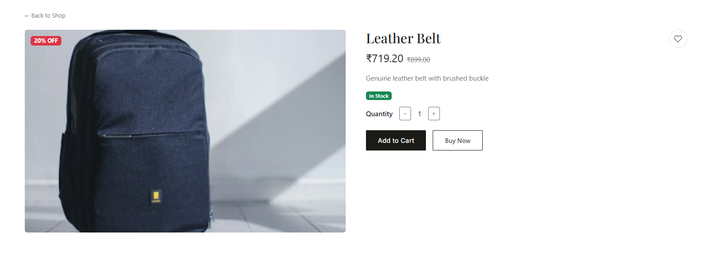
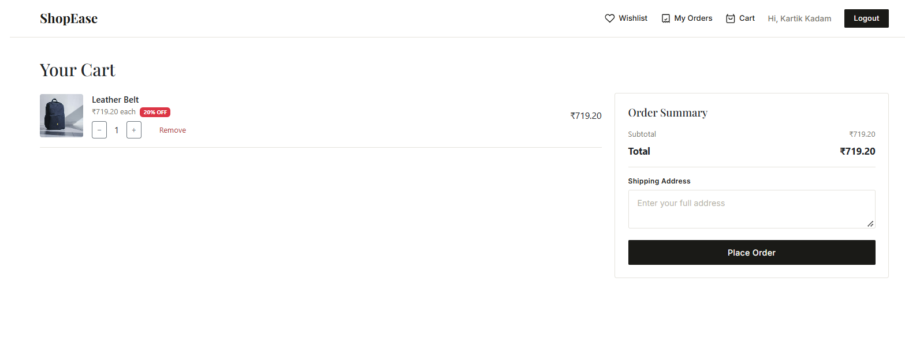
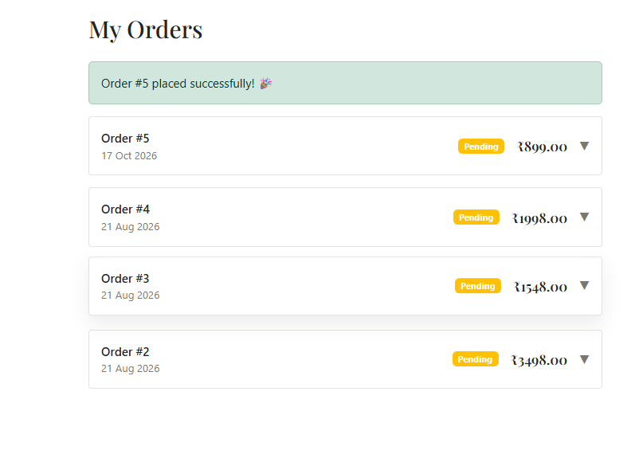
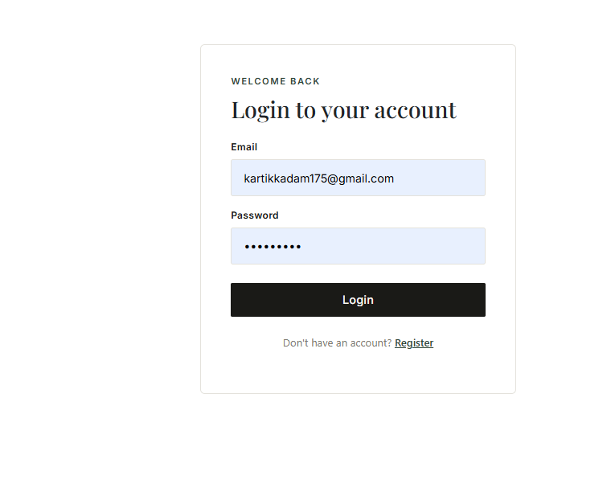

# ShopEase: Full-Stack E-Commerce App

A full-stack fashion e-commerce web app with user accounts, product browsing, cart, checkout and an admin dashboard.

**Tech stack:** React (Vite) · React Router · Bootstrap 5 · Node.js · Express · MySQL · JWT · bcrypt

## Screenshots

| Home | Product detail |
|---|---|
|  |  |

| Cart | Order history |
|---|---|
|  |  |

| Admin dashboard |
|---|
|  |

## Features

- Register and login with **JWT authentication**; passwords hashed with **bcrypt**
- **Role-based access** (customer / admin) enforced on the backend (middleware) and frontend (protected routes)
- Product listing with **search, category filter, price filter, sorting**
- Product detail page with stock status and quantity selector
- Shopping cart: add, change quantity, remove
- **Transaction-based checkout**: order creation, stock update and cart clearing succeed or fail together
- Order history with expandable order details
- Admin dashboard: add, edit and delete products

## Database design

7 relational tables: `users`, `categories`, `products`, `cart`, `orders`, `order_items`, `wishlist`.

- `order_items` links orders to products and stores `price_at_purchase`, so later price changes don't alter past orders
- Foreign keys with `ON DELETE CASCADE` / `SET NULL` keep data consistent
- Indexes on frequently queried columns

The full schema is in [`database/schema.sql`](database/schema.sql).

## API overview

| Method | Endpoint | Access |
|---|---|---|
| POST | `/api/auth/register`, `/api/auth/login` | Public |
| GET | `/api/products`, `/api/products/:id` | Public |
| GET | `/api/categories` | Public |
| POST / PUT / DELETE | `/api/products` | Admin |
| GET / POST / PUT / DELETE | `/api/cart` | Logged in |
| POST | `/api/orders/checkout` | Logged in |
| GET | `/api/orders`, `/api/orders/:id` | Logged in |
| GET / POST / DELETE | `/api/wishlist` | Logged in |

## Getting started

**Prerequisites:** Node.js 18+, MySQL 8+

1. Clone the repo and create the database:
   ```bash
   mysql -u root -p < database/schema.sql
   ```
2. Configure the backend:
   ```bash
   cp .env.example .env     # then fill in your MySQL password and a long random JWT_SECRET
   npm install
   npm run dev              # runs on http://localhost:5000
   ```
3. Run the frontend (in a second terminal):
   ```bash
   cd frontend
   npm install
   npm run dev              # runs on http://localhost:5173
   ```
4. To create an admin, register a normal account, then run:
   ```sql
   UPDATE users SET role = 'admin' WHERE email = 'your@email.com';
   ```

## Project structure

```
├── config/          MySQL connection pool
├── middleware/      JWT verification and admin check
├── routes/          auth, products, categories, cart, orders, wishlist
├── database/        SQL schema and seed scripts
├── server.js        Express entry point
└── frontend/        React app (pages, components, context, services)
```

## What I learned

- Designing a normalized relational schema and writing JOIN queries
- Securing an API with JWT and role-based middleware
- Using database transactions to keep multi-step operations consistent
- Managing global auth state in React and protecting routes
